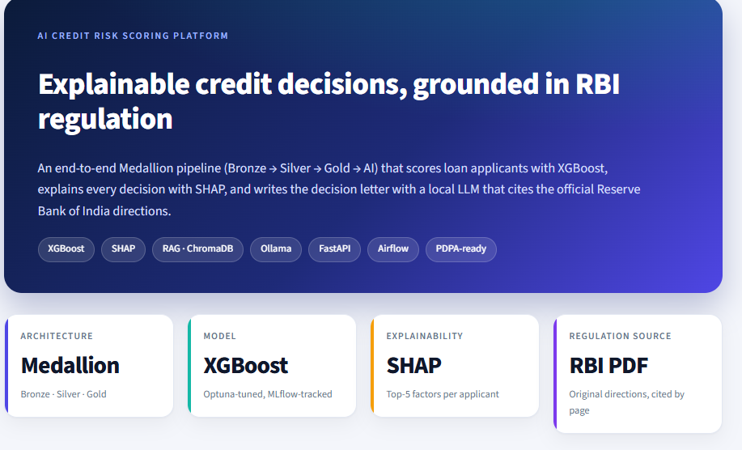
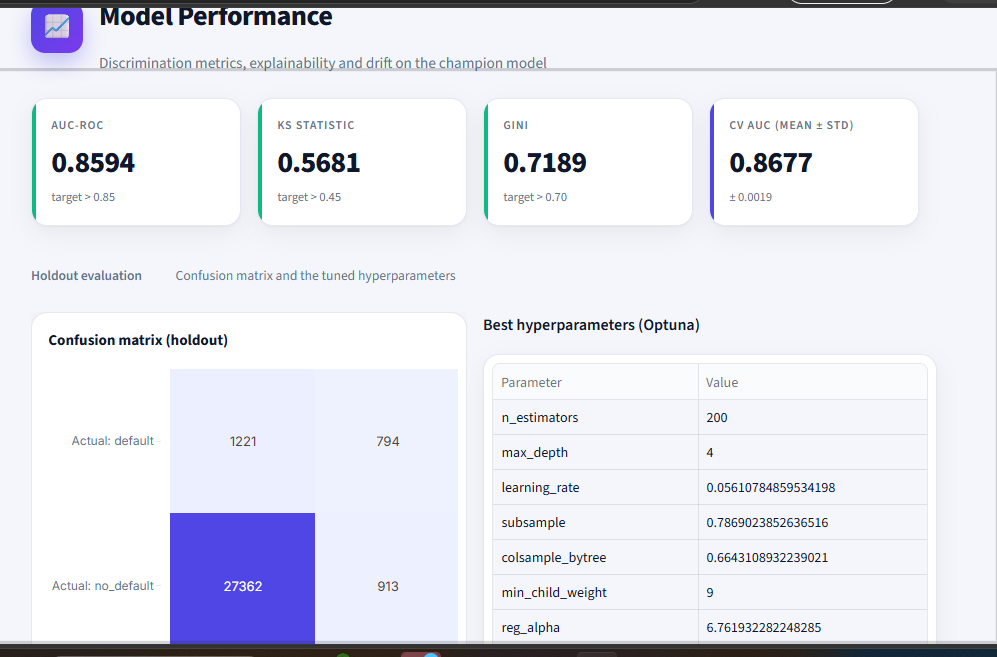
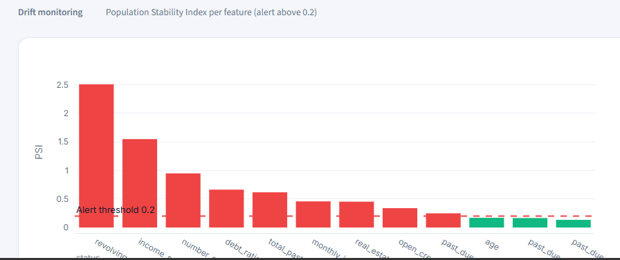

<div align="center">



</div>

> > **Regulatory grounding:** The RAG assistant retrieves relevant passages from the official RBI Financial Awareness Messages (FAME) booklet and uses those passages to ground post-rejection guidance. Retrieved sources are provided with message and page references. Responses depend on retrieval quality and should not be treated as a guarantee of loan approval.

# AI Credit Risk Scoring Platform

An end-to-end credit-risk analytics portfolio project combining
**XGBoost**, **SHAP explainability**, a **Bronze--Silver--Gold data
pipeline**, **data-drift monitoring**, and a locally hosted **RAG
assistant** for post-decline financial-literacy questions.

The project demonstrates how a credit-risk workflow can connect data
engineering, model development, explainability, API serving, monitoring,
and privacy-oriented controls in one application.

> **Portfolio/demo notice:** This is an educational portfolio project,
> not a production-ready credit decision system. The underlying public
> dataset is historical, synthetic fields are used for selected demo
> features, and the regulation knowledge base must be populated with
> verified official documents before its answers can be described as
> official regulatory guidance.

## Highlights

-   **Modeling:** XGBoost classifier with Optuna hyperparameter tuning
    and MLflow experiment tracking.
-   **Explainability:** SHAP-based feature explanations for individual
    applicant decisions and global feature importance.
-   **Data engineering:** Bronze/Silver/Gold pipeline using pseudonymous
    identifiers, encrypted PII storage, PySpark transformations, dbt,
    and DuckDB.
-   **Model monitoring:** Population Stability Index (PSI) reports for
    feature-distribution drift.
-   **Retrieval-augmented generation:** ChromaDB and
    sentence-transformer embeddings retrieve knowledge-base passages; a
    local Ollama model drafts answers using retrieved context.
-   **Serving and UI:** FastAPI endpoints and a six-page Streamlit
    dashboard.
-   **Privacy-oriented workflow:** Demonstration of data lineage and a
    right-to-erasure workflow, including a queue/SLA view.

## Model results

The repository's stored run report records the following results on a
held-out test set.

  Metric                       Stored result
  -------------------------- ---------------
  Test applicants                     30,290
  Default rate in test set             6.65%
  ROC-AUC                              0.859
  Cross-validation ROC-AUC             0.868
  KS statistic                         0.568
  Gini                                 0.719
  Brier score                          0.049

The recorded split uses a deterministic hash-based assignment, with
hyperparameter tuning performed using five-fold cross-validation on the
training portion. See [`docs/RUN_REPORT.md`](docs/RUN_REPORT.md) for the
run details and [`docs/decisions/`](docs/decisions/) for architecture
decisions.

**Interpretation and limitations**

-   These are the results recorded by the project's stored run;
    rerunning the pipeline may produce slightly different results
    because the split depends on a keyed HMAC.
-   The data comes from the historical *Give Me Some Credit* dataset and
    should not be interpreted as evidence of performance on current
    lending populations.
-   The repository documents an earlier AUC of 0.94 as label leakage and
    states that it was removed. The lower stored result is used here.
-   Model performance metrics do not establish fairness, regulatory
    compliance, or suitability for real lending decisions.

## Model performance dashboard

The screenshot below shows the stored holdout evaluation metrics, confusion matrix, and Optuna-selected hyperparameters from the dashboard.



**Metrics shown:** AUC-ROC `0.8594`, KS statistic `0.5681`, Gini `0.7189`, and cross-validation AUC `0.8677 ± 0.0019`. The holdout confusion matrix shows 794 correctly identified defaults, 1,221 missed defaults, 27,362 correctly identified non-defaults, and 913 false positives (with `default` treated as the positive class).

To display this screenshot on GitHub, save the image in your repository at `docs/images/model-performance.png` (or update the Markdown path if you choose a different location).

## Model Monitoring and Data Drift

The platform monitors feature-distribution changes using the Population Stability Index (PSI).

- Calculates PSI for individual credit-risk features.
- Flags features that exceed the configured PSI alert threshold of `0.2`.
- Visualizes feature-level PSI and alerts in the Streamlit dashboard.
- Helps investigate data-quality issues and changes in applicant populations.



**Interpretation note:** A drift alert indicates a feature-distribution change; it does not, by itself, prove model performance has degraded. Confirm which reference and comparison datasets were used before interpreting the alert as production drift. The project also reports train-versus-test PSI separately, so the README should identify the comparison used for each report.

## Application walkthrough

  -----------------------------------------------------------------------
  Dashboard page                      Function
  ----------------------------------- -----------------------------------
  **Overview**                        Application counts, approval rate,
                                      risk-tier mix, and probability
                                      distribution

  **Model Performance**               ROC-AUC, KS/Gini, confusion matrix,
                                      calibration, hyperparameters, SHAP
                                      importance, and PSI drift

  **Decision Viewer**                 Find an applicant, inspect top SHAP
                                      drivers, and generate a decision
                                      letter

  **PDPA Compliance**                 View lineage, erasure queue, SLA
                                      status, and the right-to-erasure
                                      demo flow

  **Regulation Search**               Search the indexed knowledge base
                                      semantically and inspect retrieved
                                      references

  **Loan Advisor Chat**               Ask follow-up questions after a
                                      decline, using retrieved FAME
                                      knowledge-base passages
  -----------------------------------------------------------------------

## Architecture

``` text
Public Give Me Some Credit data + generated demo applications
                         |
                         v
BRONZE  -> HMAC-based pseudonymous IDs, encrypted PII, lineage metadata
                         |
                         v
SILVER  -> PySpark cleaning, imputation, winsorization, feature engineering
                         |
                         v
GOLD    -> dbt models / DuckDB feature store
          XGBoost + Optuna + MLflow
          SHAP explanations + PSI monitoring
                         |
                         v
RAG     -> ChromaDB retrieval + sentence-transformer embeddings
          Local Ollama generation for letters and chat
                         |
                         v
SERVING -> FastAPI endpoints + Streamlit dashboard
```

## Technology Stack

| Area | Technologies |
|---|---|
| Language and Analysis | Python, SQL, Pandas |
| Data Processing | PySpark, dbt, DuckDB |
| Machine Learning | XGBoost, Optuna, MLflow |
| Explainability | SHAP |
| Data & Drift Monitoring | Population Stability Index (PSI), feature drift detection, configurable drift alerts |
| Retrieval & LLM | ChromaDB, Sentence Transformers, `all-MiniLM-L6-v2`, Ollama |
| API & Dashboard | FastAPI, Streamlit, Plotly |
| Storage & Orchestration | SQLite, PostgreSQL, Apache Airflow, MinIO|


``` bash
pip install -r requirements.txt
streamlit run src/python/dashboard/app.py
```

On Windows, you can also use `run_website.bat`. On macOS/Linux, use
`./run_website.sh` if the script is executable.

Open <http://localhost:8501>.

### Optional components

  -----------------------------------------------------------------------------------
  Component                           Setup
  ----------------------------------- -----------------------------------------------
  FastAPI service                     `uvicorn src.python.api.main:app --port 8000`
                                      then open <http://localhost:8000/docs>

  Local LLM generation                Install [Ollama](https://ollama.com), then run
                                      `ollama pull llama3.2` and `ollama serve`

  RAG embedding/index                 On first use, internet access may be needed to
                                      download `all-MiniLM-L6-v2` and build the local
                                      indexes
  -----------------------------------------------------------------------------------

The dashboard's stored pages can be explored without rerunning training.
Features that require local Ollama or a built knowledge-base index will
need those components configured.


## Post-decline RAG assistant

The post-decline assistant combines two different inputs:

1.  **Applicant-specific explanation:** SHAP factors describing which
    model features contributed to the applicant's score.
2.  **Retrieved knowledge-base context:** passages retrieved from the
    indexed financial-literacy/regulatory documents.


## Rebuild the pipeline 

Only rerun these stages if you want to rebuild the data and model
artifacts from raw inputs. The repository's pipeline notes list Java 17
or newer for PySpark, the Kaggle *Give Me Some Credit* CSV, and internet
access for dependency/model downloads.

``` bash
pip install -r requirements-pipeline.txt
python -m src.python.setup_env
python -m src.python.loaders.bronze_ingest
python -m src.python.transformers.data_cleaning
python -m src.python.transformers.feature_engineering
python -m src.python.transformers.encoding
```

Then run dbt:

``` bash
cd dbt
dbt deps
dbt run
dbt test
dbt snapshot
cd ..
```

Continue with model training and downstream artifacts:

``` bash
python -m src.python.models.train_xgboost
python -m src.python.models.model_registry --export
python -m src.python.explainability.shap_explainer
python -m src.python.scoring.scoring_pipeline
python -m src.python.monitoring.drift_monitor
python -m src.python.compliance.pdpa_erasure
```

For a lower-resource machine, consult the script's supported options
before reducing trials, folds, or sample sizes. Keep `.env` and all
generated keys out of source control.

### Storage configuration

The repository documents SQLite as the default backend unless PostgreSQL
credentials are configured. PostgreSQL mode requires the relevant
service to be running. Check `.env.example` and project configuration
for the exact settings supported by your checkout.

## Project structure

``` text
requirements.txt                 Dashboard/runtime dependencies
requirements-pipeline.txt        Full pipeline dependencies
models/champion/                 Exported model and prediction example
data/sqlite/                     Local database artifacts
dbt/                             dbt project and DuckDB development database
docs/RUN_REPORT.md               Stored model evaluation report
docs/decisions/                  Architecture decision records
src/python/
  extractors/ loaders/ generators/
  transformers/
  models/ explainability/ scoring/
  monitoring/ compliance/
  rag/ api/ dashboard/
dags/ docker/ sql/ tests/
```

## Testing

The repository documents unit, integration, and dbt tests. Run the
suites relevant to your environment:

``` bash
pytest tests/unit
pytest tests/integration
cd dbt
dbt test
```

Some integration/RAG tests may skip when Ollama or the embedding model
is unavailable. Check the test output to distinguish a passed test from
a skipped test.

## Key engineering decisions

Architecture decision records are available in `docs/decisions/`.
Documented decisions include:

-   Real public dataset over fully synthetic training data.
-   Pseudonymization at ingestion.
-   SHAP for model explanations.
-   dbt snapshots for the erasure workflow.
-   XGBoost selected with interpretability and operational simplicity in
    mind.
-   Deterministic synthetic enrichment kept separate from the model's
    documented 12-feature contract.
-   A shared feature contract across training, scoring, and explanation.

## Known limitations and responsible-use notes

-   **Not a production credit model.** It is a portfolio demonstration;
    it has not been validated for real-world lending decisions.
-   **Historical dataset.** The public data is old and may not represent
    current applicants or markets.
-   **Synthetic demo fields.** The repository documents that fields such
    as `loan_purpose`, `employment_type`, and selected income-stability
    fields are generated for demonstration and are not model features.
-   **Drift interpretation.** The stored train-vs-test report has a
    maximum PSI of 0.0008. The repository separately notes that
    generated applications intentionally create larger drift values. A
    low PSI does not prove that model performance is good.
-   **Regulatory knowledge base.** Simulated text may be present unless
    verified official documents are added and indexed.
-   **Fairness assessment.** A full fairness/bias analysis has not been
    completed.
-   **Privacy workflow.** The erasure implementation and retention scope
    require appropriate legal/privacy review before real use.
-   **Secrets and data.** Do not commit `.env`, encryption keys,
    credentials, or applicant-level data. Review the repository contents
    before publishing it publicly.

## Future improvements

-   Add versioned, authoritative regulatory documents with page-level
    citations and automated source-grounding tests.
-   Evaluate RAG retrieval and answer faithfulness on a labelled
    question set; tune the distance threshold using measured
    precision/recall rather than guesswork.
-   Add fairness analysis, subgroup evaluation, and documented
    model-risk review.
-   Improve local LLM latency and enforce structured validation of
    generated decision letters.
-   Add authentication, role-based access control, rate limiting, and
    deployment/load tests for the API.

## License

The project notes an MIT license. 